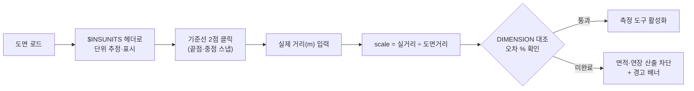
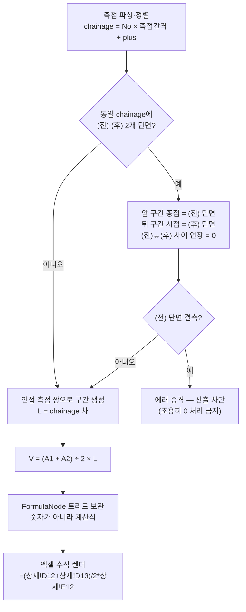
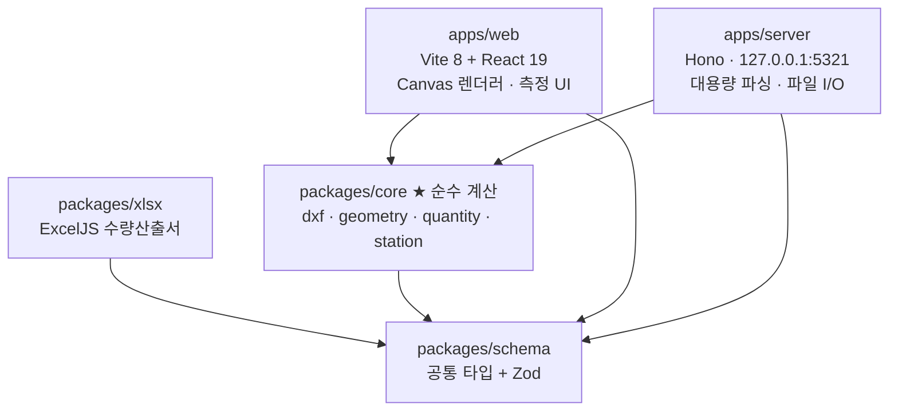

# S-CUBE

> **S-CUBE** (에스큐브) — *Saman Quantity Cube*
> 단면(㎡) × 연장(m) = 체적(㎥). 도면에서 바로 수량을 산출하는 토목 수량산출 도구.

DXF 도면에서 단면적과 연장을 직접 취득하고, 재료 규격을 입력하면
**산출근거가 수식으로 살아 있는 수량산출서(xlsx)** 를 생성한다.

---

## 무엇을 하는가

1. **도면 로드** — DXF를 열고 축척을 캘리브레이션한다
2. **측정** — 단면 폴리라인을 클릭하면 면적, 선·치수를 클릭하면 연장이 나온다
3. **산출** — 측점별 단면적을 모아 양단면평균법으로 체적을 계산한다
4. **규격** — 재료 규격과 할증·환산을 적용한다
5. **출력** — 산출근거 상세형 수량산출서를 엑셀로 내보낸다

모든 수량은 **어느 도면의 어느 객체에서 나왔는지** 끝까지 역추적된다.
엑셀 셀에는 값이 아니라 **수식**이 들어가므로 감리·발주처가 계산 과정을 확인할 수 있다.

## 동작 원리

### 산출 파이프라인


### 축척 캘리브레이션 — 검증 없이는 산출하지 않는다



### 체적 산출 — 양단면평균법과 전/후 불연속 처리



### 패키지 구조



## 설계 원칙

- **완전자동이 아니라 반자동.** 실무 도면은 폐합되어 있지 않고 레이어 규칙도 제각각이다.
  사람이 판단하고 도구가 계산·기록한다.
- **축척은 반드시 검증한다.** 캘리브레이션 없이는 면적을 산출하지 않는다.
- **원본 도면은 수정하지 않는다.** 읽기 전용.

## 기술 스택

| 항목 | 선택 |
|---|---|
| 런타임 | Node.js 24 LTS |
| 패키지 매니저 | pnpm (workspace) |
| 번들러 | Vite 8 (Rolldown 내장) |
| 언어 | TypeScript (strict) |
| Lint/Format | Biome |
| UI | React 19 + Canvas 2D |
| 서버 | Hono (로컬 전용, 127.0.0.1) |
| Excel | ExcelJS |

## 개발

```bash
pnpm install   # 의존성 설치 (Node 24+, pnpm)
pnpm dev       # 웹(5320) + 로컬 서버(5321) 동시 기동
pnpm check     # Biome lint/format + tsc 타입체크
pnpm test      # Vitest
pnpm build     # 전체 빌드
```

## 현재 상태

**개발 진행 중.** 상세 계획은 [`PLAN/`](./PLAN) 참조.

| 문서 | 내용 |
|---|---|
| [00-OVERVIEW](./PLAN/00-OVERVIEW.md) | 프로젝트 개요·범위·로드맵 |
| [01-REQUIREMENTS](./PLAN/01-REQUIREMENTS.md) | 기능·비기능 요구사항 |
| [02-ARCHITECTURE](./PLAN/02-ARCHITECTURE.md) | 시스템 구조·기술 스택 |
| [03-DATA-MODEL](./PLAN/03-DATA-MODEL.md) | 데이터 모델 |
| [10~16 PHASE](./PLAN) | Phase 0~6 단계별 실행 계획 |
| [20-RISKS](./PLAN/20-RISKS.md) | 리스크 대장 |
| [21-CONVENTIONS](./PLAN/21-CONVENTIONS.md) | 개발 규약 |

### 로드맵

| Phase | 내용 | 상태 |
|---|---|---|
| 0 | 스캐폴딩·툴체인 | **완료** |
| 1 | DXF 로드·렌더·캘리브레이션 | **구현 완료** — 실도면 검증 대기 |
| 2 | 면적·연장 측정 | 예정 |
| 3 | 측점·구간·양단면평균법 | 예정 |
| 4 | 규격 마스터 + 엑셀 출력 **(MVP)** | 예정 |
| 5 | 자동 폐합 탐색·레이어 규칙 | 예정 |
| 6 | 검증 리포트·배포 | 예정 |

## 제약

- DWG는 직접 읽지 않는다. **DXF로 저장 후 사용** (Phase 5에서 ODA 변환기 연동 예정)
- 도면 파일은 외부로 전송되지 않는다. 전 기능 오프라인 동작.

---

삼안(주) 이현중(hjlee@samaneng.com) · 토목 수량산출 자동화
